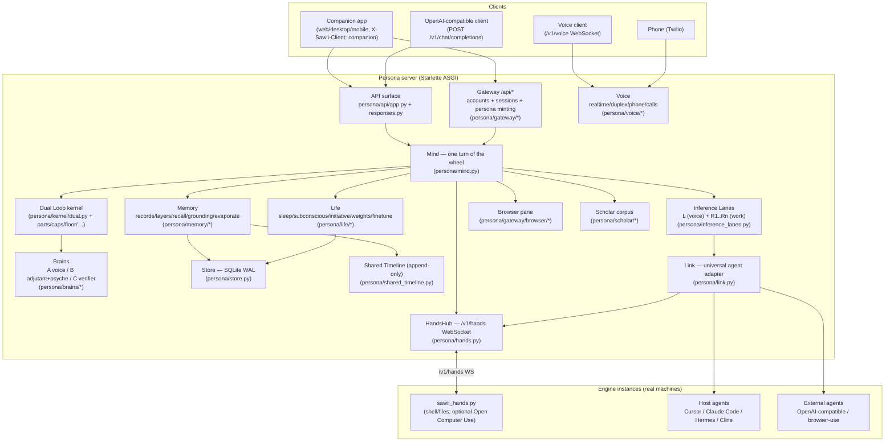
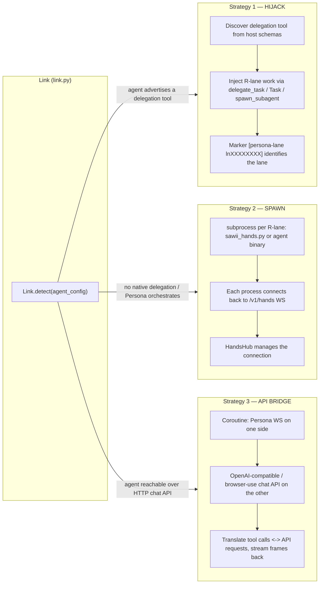

# Architecture — Sawii Persona ("Hands")

> Source of truth: GitHub clone at `C:\Users\anasa\hands-gh`, branch `main`, commit `19d5678`.
> Every claim below is traceable to code read at that commit. Where a module is large
> and its behavior is only partly certain, uncertainty is stated explicitly.

---

## 1. What this system is

Sawii Persona is a **three-lobe AI companion** ("the mind") that can be *met* two ways:

- **Companion (home)** — the app. The mind has her own computer and browser, a voice you
  can talk over, memory, a workshop, and hands on the person's machine. Requested with
  header `X-Sawii-Client: companion`.
- **Inference (a visit)** — the same mind behind an OpenAI-compatible
  `POST /v1/chat/completions` (public model id `sawii-persona`). The caller brings its own
  tools; she decides the calls; the caller runs them. Her browser and computer stay home.

One mind. Two products. The switch is documented in `persona/products.py`
(`COMPANION_FEATURES`, `INFERENCE_FEATURES`, `describe()`).

Around that mind sits a **Link** that connects Persona to *any* external agent, and a set of
**engine instances** ("hands") that execute real work on real machines.

---

## 2. Top-level component graph



---

## 3. The three lobes

The mind is **the two lobes** (kernel docstring, `persona/kernel/__init__.py`: *"The dual loop:
one voice, two writings, one model."*). In practice three roles appear:

| Lobe | Role | Code |
|------|------|------|
| **A — the voice** | Speaks to the person, streams speech, runs tools mid-sentence. | `persona/brains/voice_a.py` (`speak`, `FeelFilter`, boundaries) |
| **B — the adjutant / psyche** | Runs *after* A answers (never blocks the person): notes, loops, corrections, the Conversation Board, the Execution Blueprint, longitudinal read of the person. | `persona/brains/adjutant.py` (`review`), `persona/brains/observer.py` (`read_psyche`), `persona/brains/rememberer.py`, `persona/conversation_board.py`, `persona/execution_blueprint.py` |
| **C — the verifier / psyche** | Independent verification of each answer; verdicts GREEN / YELLOW / RED; longitudinal user psyche; night anchor data. | `persona/brains/verifier.py`, `persona/brains/meter.py` (`Meter`, `compute_meter`, `rate`, `review_with_retry`) |

`persona/brains/prompts.py` ("Every prompt in the system, in one place") and
`persona/brains/live.py` (`gut_read`, `live_check`) supply their live behavior;
`persona/brains/consults.py` (`Consult`, `ConsultBoard`) runs parallel consultant models the
moment a question arrives.

### The dual loop (`persona/kernel/dual.py`, 3571 lines)

This is the core. It runs **one voice, two writings, one model**: the *speaking* writing (L)
streams to the person while the *silent* writing (R) drafts the next thought / next tool calls
at sentence boundaries without breaking the cached prompt prefix.

Internal structure (verified class/def list):

- **`HoldFilter`** (l.158) — holds back partial tokens so a sentence can be re-aimed before it
  is spoken; exposes `feed`/`flush`/`handoff`/`task`/`intent`/`hold`.
- **`MetaFilter`** (l.855) — strips meta/self-referential output (`is_meta`, `echoes`,
  `restates`, `reasks`, `recaps`, `says_again`, `paraphrases`).
- **`Beat`** (l.937) — one unit of the loop.
- **`DualResult`** (l.953) — result of a turn (`switches()`, `trace()`).
- **`DualLoop`** (l.994) — the engine. Key methods:
  - `run()` (l.1286, ~940 lines) — the main turn loop.
  - `stream()` (l.1264) — streaming entrypoint.
  - `interrupt()`, `hear_inner()`, `_drain_inner()` — mid-turn steering.
  - `_speak()` (l.2465, ~300 lines) — the actual speaking pass.
  - `_arm_draft`/`_wait_draft`/`_refresh_draft`/`_choose_draft`/`_hand_whole` — the
    draft-ahead machinery at sentence boundaries.
  - `_hands()` (l.3136) — turn the model's tool calls into real execution.
  - `_think`/`_think_inner`/`_silent_chat`/`_prefetch`/`_prefetch_inner` — the silent writing.
  - `_check`/`_apply_verdict`/`_publish_late_verification` — wiring C's verdict back in.
  - `_land_hands`, `_kernel_todo`, `tool_checklist`, `tool_evidence` — tool bookkeeping.
  - Module-level helpers: `trim_history`, `_parallel_safe`, `_hand_groups`, `_reground_name`,
    `_screen_tool`, `_reads_screen`, `parse_todo`, `task_parts`, `drop_dangling_bridge`,
    `strip_interjection`.
- **`_Gate`** (l.3483) — output gate that can release a corrected reply (`release(override=…)`).

Supporting kernel modules:

- `persona/kernel/caps.py` — `MemoryCap`, `ToolsCap`, `VerifyCap`, `InsightCap`,
  `CapabilityBundle`, `NullCapabilities`. What a host may give the loop and what it may withhold.
- `persona/kernel/writings.py` — `Writing`, `writings()`: the two internal passes.
- `persona/kernel/floor.py` — `requested_starter`, `starting_lobe`: cheap floor selection.
- `persona/kernel/parts.py` — split independent parts of a task across lobes (`split_parts`,
  `run_parts`, `can_run_in_part`).
- `persona/kernel/lane_routing.py` — the routing contract (`router_block`, `lane_prompt`,
  `normalize_lane`, `split_steering`, `addressed_steer`, `may_act_on_user_turn`).
- `persona/kernel/hosts/companion.py` — host adapter binding the companion `Mind` to kernel
  capabilities (`RecallMemory`, `HostTools`, `MeterVerify`, `TwoSidedInsight`, `bundle_for_companion`).
- `persona/kernel/openai_surface.py` — the dual loop as an OpenAI-compatible endpoint
  (`split_messages`, `stream_chunks`, `completion_body`, `create_app`).
- `persona/kernel/adaptive.py` — durable task state + process-safe leases (`Task`, `TaskLedger`,
  `AdaptiveCoordinator`, `LeaseBusy`).
- `persona/kernel/goal_agent.py` — model-driven persistent goals (`GoalAgent`).
- `persona/kernel/task_runtime.py` — evidence-gated task runner (`AdaptiveTaskRunner`,
  `WorkItem`, `WorkResult`).
- `persona/kernel/execution_pool.py` — `ExecutionPool`, persona-wide R execution lanes.
- `persona/kernel/conflict_coordinator.py` — `ActionIntent`, `ResourceConflictCoordinator`,
  conflict-aware admission for independent R workers.
- `persona/kernel/screen_plan.py` / `screen_prove.py` — the earliest NeuralAgent loop: plan →
  prove-on-screen (`ScreenPlan`, `parse_plan`, `ground_index`; `screen_proves`, `prove_or_wait`).

---

## 4. Inference Lanes — L and R

`persona/inference_lanes.py` (1350 lines) is what makes the mind concurrent. The **voice**
(L) talks while every **line of work** (R1..Rn) keeps moving. Public surface: `Line`, `LaneBook`,
`line_of`, `run_lanes`; scheduling helpers `write_targets`, `claims_only`, `same_work`,
`group_starts`, `ClaimGate`, `Round`, `lane_mark`, `marked_lane`, `Transcript`, `read_transcript`.

The dynamic router proposes work; DAG dependency analysis and **write-conflict collision
detection** (`write_targets`, `claims_only`, `group_starts`) keep parallel lanes safe. Lanes are
persisted, so a line survives a restart and can later be steered or stopped.

`persona/live_commands.py` is the durable **control plane** over those lanes: `LiveCommands`
with `submit`/`get`/`list`/`active_lanes`/`mark_applied`/`retry_pending`/`recover_on_startup`.
A `202` means durably accepted, not that a remote tool was interrupted. `target_type` is one of
`auto|goal|lane|host`, `action` one of `steer|cancel`. The router (`_classify_targets`) uses the
cheap lobe to choose *existing* active tasks a message corrects — it never creates tasks.

`persona/host_lanes.py` (`parse_lane`, `lane_lock_key`, `scope_key`, `use_host_tool_kernel`,
`additional_host_task`, `choose_host_inference`, `cursor_alias_model_id`) defines the explicit
Persona lane contract and the async request scope. `persona/host_delegation.py`
(`is_host_background_tool`, `route_host_output`, `_checked_action`) validates host tool schemas
and dedups actions without spoofing.

---

## 5. R-lane spawn / call / result sequence

This is what actually happens when Persona delegates a line of work to a spawned engine
(`stitch.py` auto-spawn hook + `persona/link.py` spawn strategy + `persona/hands.py`).

```mermaid
sequenceDiagram
    autonumber
    participant U as Person (companion app)
    participant M as Mind (mind.py)
    participant LB as LaneBook (inference_lanes)
    participant LK as Link (link.py)
    participant ENG as sawii_hands.py engine
    participant HUB as HandsHub (hands.py)
    participant K as Kernel (dual.py)

    U->>M: message
    M->>K: dual turn begins (L speaks)
    K->>LB: router proposes independent work
    LB->>LB: create Line (R lane), persist
    LB->>LK: lane_start_with_spawn hook (stitch.py)
    HUB->>HUB: connect(pid, send, tools, place="computer")
    LK->>ENG: spawn process (sawii_hands.py --url --key --root --approve)
    ENG->>HUB: {"type":"hello","key","tools","place":"computer","host"}
    HUB->>HUB: persona_by_key(store, key) -> authenticate
    HUB->>ENG: {"type":"ready","persona","tools":[...]}
    Note over LB: line.delegated = True, host_status = "spawned"
    K->>HUB: call(pid, "computer_shell", {...})
    HUB->>ENG: {"type":"call","id","name","arguments"}
    ENG->>ENG: resolve path inside roots; approval gate (ask/writes/auto)
    ENG-->>U: (if "ask") terminal/UI approval prompt
    ENG->>ENG: subprocess.run(...) or file op
    ENG->>HUB: {"type":"result","id","ok":true,"output":...}
    HUB->>HUB: result() -> resolve pending Future
    HUB->>K: tool result text folded into next beat
    K->>M: speak result / continue
    HUB->>U: bus.publish "screen" / "hands" status (live)
```

Key frames (from `persona/hands.py` docstring, wire protocol over `/v1/hands`):

```
runner -> server  {"type":"hello","key","place":"computer"|"cloud","tools":[...],"host":...}
server -> runner  {"type":"ready","persona","tools":[...]}
server -> runner  {"type":"call","id","name","arguments"}
runner -> server  {"type":"result","id","ok":true,"output":...}
runner -> server  {"type":"status","kind":"approval","text":...}   (waiting on the person)
server -> runner  {"type":"cancel","id":...}                        (the turn let go of that call)
```

Two places may be connected at once (`computer` and `cloud`); tools reach the model prefixed
`computer_<tool>` / `cloud_<tool>` (`HandsHub.connect`). A newer connection for a place replaces
an older one. `place` names appear in `hands.PLACES`.

---

## 6. The Link — universal adapter, three strategies

`persona/link.py` (1293 lines) is *the single unit of connection* between Persona and any agent.
What Persona sees is always the same: pure hands WebSocket frames. What the agent sees is
whatever native protocol it speaks. Strategies are chosen automatically by `Link.detect`.



**Drivers** (one per agent type) in `link.py`:

- `AgentDriver` (ABC), `GenericHijackDriver`
- `HermesDriver` — `delegate_task` with a tasks array; spawn/steer/stop/list
- `CursorDriver` — `Task` / `task` with prompt + `run_in_background`; lifecycle receipts land
  via `persona/cursor_bridge.py` (`receive_cursor_subagent`, marker regex
  `\[persona-lane (ln[0-9a-f]{8})\]`)
- `ClaudeCodeDriver` — `Agent` / `spawn_subagent`
- `ClineDriver` — `Task` / `launch_subagent`
- `OpenAIBridgeDriver`, `BrowserUseDriver` — the API-bridge strategies

`AgentProfile` (strategy, agent_type, delegation_tool, binary/url/key/model, roots, approve,
place), `LinkedLane` (lifecycle + host state + pending results), `Link` (delegate/steer/stop/
status/pending_calls/receive_result), `LinkRegistry` (register/get/info/strategies/set_hub/
shutdown_all). Timeouts: `SPAWN_CONNECT_TIMEOUT=60`, `HIJACK_ACK_TIMEOUT=30`, `API_CALL_TIMEOUT=120`.

> **Important honesty note** (from `cursor_bridge.py`): a host child completion is **not**
> independent verification (`"Cursor <status> (unverified): ..."`). Cursor's `subagentStart`
> fires before actual creation, so a start is recorded as `launch_observed`, and only an
> explicitly marked task becomes a Persona lane.

---

## 7. The context stream (how one line of thought is assembled)

`persona/context.py` builds a *single system message* (stable part first, live part last, so it
works with chat templates that only accept a leading system turn):

```
STABLE (cached prefix):
  A_BASE + persona_frame(definition, name)
  the picture of them           (always worth its tokens; changes rarely)
  A's self-narrative            (rewritten only at sleep)
  knowledge (voices from uploaded files)
LIVE:
  now  (clock)
  passages (retrieved for this moment)
  === your adjutant (B), privately ===
      CORRECTION REQUIRED / conscience note / meter carry-forward /
      lane questions / standing rules / dropped / loops / integrity record
  B's read of them (psych_profile, hedged hunches)
  inner minds disagree (B vs C dissent)
  habits B sees in you
  mood (EMA) + last A chord + user mood + last B chord
  came back to you right after you answered (sudden)
  on your mind (what the other minds kept thinking)
  === memories === (stitched, labeled, dated)
then: verbatim tail turns (server-side journal, any device)
then: the person's message
```

`Scratch` (per-persona, never written to the DB — "the conscience must not become a memory that
cites itself") carries: `conscience`, `correction`, `sudden`, `psyche_brief`, `dissent`,
`meter_carryforward`, `lane_questions`, `dropped`, `last_consults`, `aging`.

---

## 8. Memory architecture

`persona/store.py` — **single source of truth**, SQLite WAL. Tables (verified in
`store.py` / `live_commands.py` / `decision_map.py`): `personas`, `turns`, `events`, `layers`,
`hypotheses`, `entities`, `loops`, `rules`, `verdicts`, `anchor_runs`, `updates`, `thoughts`,
`outbox`, `juice`, `finetune_jobs`, `character_anchors`, `rulings`, `rulings_fts`, `escalations`,
`live_commands`, `persona_decisions`, `shared_timeline`, knowledge + scholar tables.

`persona/memory/`:

- `records.py` (`Memory`, `content_words`, `polarity`, `parse_due`, `vec_matrix`) — one record per
  event, three authored layers, entities/loops/rules.
- `recall.py` (`Recall`, `RecallResult`, `render_event`, `format_similarity_alerts`) — broad in,
  ranked out, stitched by 3 layers, labeled and dated. Loose band (`RECALL_BAND` default 0.30);
  "open sesame" near-match named unasked at `OPEN_SESAME_THRESHOLD` default 0.78.
- `grounding.py` (`ground`, `_clean_quote`) — **quote-or-die**: nothing is attributed to the user
  unless their exact words exist.
- `search.py` (`search_all`) — one retrieval entrypoint: semantic + lexical long-term memory,
  document passages, journal.
- `evaporate.py` (`gist_of`, `trace_of`, `occupancy`, `candidates`, `evaporate`) — "the overflowing
  cup": consolidated records may stop being carried once the raw cup (`CUP_CHARS`, default 400k)
  overflows.

`persona/shared_timeline.py` — `SharedTimeline`, the append-only, persona-scoped conversation and
tool event log; the authoritative record across lobes/lanes (also the source the Conversation
Board and Execution Blueprint warm-load from).

---

## 9. Gateway (home layer) and browser pane

`persona/gateway/` is the **accounts/workspace layer**, distinct from the mind (`/v1/*`):

- `auth.py` — bcrypt passwords, bearer sessions (`create_session`, `login`, `register`,
  `rate_limit`, `require_user`, `revoke_token`). Env: `SAWII_GATEWAY_DB`, `SAWII_SESSION_TTL`,
  `SAWII_ALLOW_REGISTRATION`, `SAWII_RATE_LIMIT_PER_MINUTE`.
- `db.py`, `middleware.py` (`RequestIdMiddleware`), `personas.py`
  (`provision_persona_for_user`, `get_persona_for_user`), `routes.py`
  (`/api/auth/register|login|me|logout`, `/api/persona`).
- Enabled by `SAWII_GATEWAY=1`; routes may be mounted onto the main app
  (`register_gateway_routes`).

`persona/gateway/browser/` — **Shape B** wrap of a browser-use session for the companion pane:

- `session.py` (`BrowserSessionProto`, `Snapshot`, `read_page`, `DryRunSession`, `RealSession`,
  `PlaywrightSession`, `create_browser_session`, `_chrome_path`).
- `tools.py` (`BrowserTools`) — a `ToolsCap`; `schemas(mode)` is asymmetric: **L** gets action
  tools (`browser_navigate/click/type/scroll/back/wait_for_selector`) + observation;
  **R** gets observation only (`browser_snapshot`).
- `insight.py` (`BrowserPaneInsight`, an `InsightCap(mode="L")`), `stream.py`
  (`BrowserBroadcast`), `routes.py` (`BrowserHub`, `register_browser_routes`), `tasks.py`
  (`MindBrowserLanes`, `BrowserTasks`, `task_schemas`), `edited.py` (`EditedBrowserSession`).
- Enabled by `SAWII_BROWSER_PANE=1` (default on); `SAWII_BROWSER_DRY_RUN=1`, `SAWII_BROWSER_CDP_URL`.

---

## 10. Voice, life, scholar, training

### Voice (`persona/voice/`)

- `realtime.py` (1119 lines) — "the lag budget is everything": `SentenceChunker`, `SpeechIO`,
  `VoiceSession`, `open_ended`, `tts_body`, `_clause_cut`, `parse_frame`.
- `duplex.py` (`DuplexVoice`), `native_input.py` (`NativeAudio`, `decode_native_audio`,
  `AudioReviewer`, `AudioAttachedLLM` — "a recording is not a user quotation"),
  `phone_stream.py` (`TwilioMediaStream`, mulaw/PCM conversion), `calls.py`
  (`CallHub`, `CallSession`, `register_call_routes`, TwiML), `clone.py` (saved voice),
  `tinker_audio.py` (legacy opt-in transcription).

### Life (`persona/life/`) — everything slow, never on a turn

- `sleep.py` (`Sleep`) — nightly circadian pass (nights, narrative rewrite, curiosity).
- `subconscious.py` (`Subconscious`, `chord_distance`, `style_score`) — the "juice" buffer.
- `initiative.py` (`Initiative`) — always-on, speaks first when it has a reason (heartbeat,
  quiet hours, daily outreach cap).
- `weights.py` (`WeightStore`, `Learner`, `Backend`, `ToyBackend`, `backend_from_env`,
  `memory_texts`, `fact_texts`) — the two copies she speaks from, AL (fast) and AR (slow).
- `update.py` (`Updater`, `reward_for`, `strategy_feedback`) — per-turn weight update (honest
  no-op when `UPDATE_URL` is empty).
- `fastweight.py` (`FastWeightDelta`, `LRDivergenceMeasurer`, `EMASynchronizer`) — per-turn
  learning via L/R divergence.
- `finetune.py` (`FineTuner`, `compress_text`) — the dream: bake juice into weights.
- `anchor.py` (`wrong_cases`, `anchor_run`), `character_anchor.py`
  (`recognize_tonal_correction`, `character_anchor_run`) — factual and tonal "wrongness" datasets.
- `speaking.py` (`Speaking`), `mouth.py` (`is_coreweave`, `publish_adapter`, `artifact_ref`).

### Scholar (`persona/scholar/`) — Arabic corpus + fiqh arithmetic

`normalize.py` (fold letters/digits/punct to make Arabic searchable without altering it),
`robots.py` (honest robots.txt), `store.py` (`ScholarStore`, `open_store`), `calc/mirath.py`
(deterministic inheritance shares in exact fractions), `crawl/` (polite harvester: `base.py`,
`books.py`, `fatwas.py`, `videos.py`, `urls.py`, `__main__.py` CLI).

### Training

`persona/training_bundle.py` (`assemble`, `verify_bundle`, `check_leakage`,
`authored_examples`, `dynamic_messages`, `launcher_partitions`), `persona/tajweed_training.py`
(`plan_training`, `validate_sample`, `choose_lobe_models`), `persona/agentic_training.py`
(`validate_execution_evidence`, `coordination_report`), `persona/connected_policy.py`
(`GoalConditionedPolicy`, `LearnnedCoordinator`, `train_verified_goal_policy`),
`persona/connected_training.py` (`run_connected_episode`, `team_reward`),
`persona/decision_map.py` (`DecisionJournal` — reviewed-successes-only SFT export).

### Products and prompts

`persona/products.py`, `persona/profiles.py` (`PRESETS`, `build_clone`, `persona_frame`),
`persona/emotion.py` (chords over 8 axes, `resonance`, `render`, `parse_declaration`),
`persona/blocks` are all user-authored — "the persona is written by the user".

---

## 11. Request path (a companion turn, end to end)

1. Client hits `POST /v1/chat/completions` (or `/v1/responses`) with the persona key and
   `X-Sawii-Client: companion`. `persona/api/app.py` authenticates via
   `persona/identity.py` (`persona_by_key`).
2. `Mind.respond()` → `_respond_inner()` (`persona/mind.py`). The turn assembles context
   (`context.build_messages`), recall (`memory.recall`), the Persona clock (`timesense`).
3. The **dual loop** runs (`Mind._dual_speak` → `kernel.dual.DualLoop.run`): A speaks, B/C run
   live (`_LiveLobes`, `brains/live`, `brains/verify`), tools dispatch to `HandsHub`
   and/or browser.
4. After the reply: B's adjutant review, Conversation Board evolve, Execution Blueprint evolve,
   memory write (`memory.records`), C's verdict (`brains.meter`), aging (`life.update`),
   optional deep lane.
5. Live events publish on `Bus` (`mind.Bus`): kernel steps, screen frames, live-command states,
   hands status; the companion UI subscribes.

---

## 12. Trust boundaries and invariants

- **The shared server never runs a shell for anyone.** Shell/files run in `sawii_hands.py` on the
  person's machine or in a cloud sandbox (`hands.py` docstring).
- **Quote-or-die**: memory attribution requires the user's exact words (`memory/grounding.py`).
- **Unverified ≠ verified**: host child completion is not independent verification
  (`cursor_bridge.py`); the meter (`brains/meter.py`) is the verifier.
- **A `202` on a live command means accepted, not applied** (`live_commands.py`).
- **The persona definition is context only**: never written into memory, never learned from
  (`profiles.py` docstring).
- **Weights lock (2026-10-21)**: a home turn may take one learning step when a backend is on; a
  visit does not update weights (`products.py`).
- **Alias table is a whitelist**: `resolve_cursor_alias` returns `""` for anything not in the
  table, so an attacker/host model string can never pass through to the provider (`config.py`).

---

## 13. Uncertainties / notes

- `persona/kernel/dual.py` is 3571 lines; the summary above captures its public classes and the
  named method groups, but its ~60 top-level helper functions and the ~940-line `run()` are only
  described at the level of their names and docstrings, not line-by-line.
- The repo contains committed `__pycache__/*.pyc`. Some `.pyc` reference modules with no `.py`
  source at this commit (e.g. `world_map`, `architecture/*`, `brains/director`) — **stale build
  artifacts**. Only `.py` source was used as truth here. This is worth cleaning up.
- The companion **web UI is not in this repository**; `config.py` refers to a separate
  `companion-app` deployment. This repo serves the developer console at `/app` and the gateway
  `/api/*` for a separately hosted client.
